<!-- Everything that moves lives inside the SVGs: GitHub strips <script> and
     inline styles from READMEs, but plays SMIL / CSS animations in  SVGs. -->

<h3><code>subhajit@github ~ $ whoami</code></h3>

<!-- portrait (left) + neofetch card (right): both canvases are 840x880,
     so equal widths give equal heights.
     portrait: python scripts/prep_photo.py && python scripts/make_ascii_svg.py
     card:     python scripts/make_info_card.py -->
<table>
<tr>
<td valign="top"></td>
<td valign="top"></td>
</tr>
</table>

 

<!-- real contribution data, re-scraped + re-rendered daily by
     .github/workflows/update-profile-art.yml -->

<h3><code>subhajit@github ~ $ ./contributions.sh</code></h3>

 
 

<h3><code>subhajit@github ~ $ ./links.sh</code></h3>

<b>AI &amp; Full-Stack Developer · Machine Learning · React · Python</b>

 

